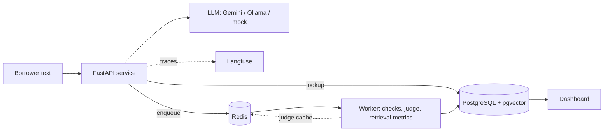

# Voice Agent Audit: evaluation kit for Hinglish payment-reminder voice agents

Formerly named `hveval`.

A synthetic, text-mode collections agent plus the tooling to evaluate it in layers: rule checks, an LLM judge calibrated
against human labels, translation metrics, metamorphic tests, retrieval (RAG) evaluation, and a FastAPI service backed by
PostgreSQL/pgvector, Redis and optional Langfuse tracing. All data is synthetic. **Numbers are reported only when measured;
anything produced on the mock backend or from unreviewed drafts is labeled as such.**

## Results so far (measured, with caveats)
| what | result | caveat |
|---|---|---|
| Prompt size, `pruned` vs `static`, real model (`gemini-3.5-flash-lite`, 120 scenarios each) | 806 to 455 prompt tokens (**43.5% fewer**) | provider-reported token counts; single run on the free tier |
| Rule checks, same real-model run | decision 120/120 (`static`) vs 119/120 (`pruned`); no account disclosure 118/120 vs 115/120; valid tool args 116/120 vs 115/120; JSON, invented figures, banned phrases and length all pass | gaps of 1 to 3 failures in 120 are within noise, so quality parity is not established. Latency (p50 about 6 s) includes free-tier retry waits and is not model speed |
| Retrieval, best of 5 setups (multilingual model + BM25) | recall@3 **0.53** (95% CI 0.40 to 0.65) on 49 queries | gold queries drafted by the assistant, 0 human-reviewed; CIs overlap between most setups |
| Dense multilingual model alone, Hinglish queries | recall@3 **0.11** vs 0.54 on English | Roman-script Hindi is poorly handled; hybrid with BM25 recovers it |
| Context recall on 60 scenarios | **0.44** (0.33 to 0.55) best setup vs 0.24 (0.15 to 0.34) default | required-chunk map drafted by the assistant |
| pgvector vs in-memory ranking | identical top-3 on all queries | checked once, `hash` embedder |
| BLEU/chrF on wrong-amount translations | average about 0.90 (BLEU) and 0.96 (chrF), versus 0.14 / 0.57 for word salad | synthetic degradations; shows the metric is blind to wrong facts, which a fact check catches |

**Not measured yet:** judge-vs-human agreement (needs 160 human labels), metric-vs-human correlation for
translations (needs 60 ratings), real-model faithfulness, context recall and metamorphic results (runs in progress),
any cloud deployment. **Verified live:** Langfuse accepted a test trace (2 events accepted, 0 errors).

## Architecture

Deployment notes are in `deploy/README.md`.

## Status by stage
- [x] Weekend 1: synthetic personas, ASR noise, `static` vs `pruned` prompts, 7 deterministic checks, promptfoo + CI
- [x] Weekend 2 code: transcripts + notes with seeded defects, labeling tool, LLM judge, kappa + bootstrap CI, bias probes. **0 / 160 human labels.**
- [x] Weekend 3 code: BLEU/chrF + fact check, metamorphic tests, dashboard. **0 / 60 human ratings.** (COMET intentionally skipped: disk and cost.)
- [x] Phase 1: FastAPI + PostgreSQL service, Docker Compose
- [x] Phase 2: policy corpus in pgvector, `/retrieve`, `rag` variant, retrieval evaluation. **0 / 49 gold queries human-reviewed.**
- [x] Phase 3: Redis judge cache and job queue + worker, p50/p95 latency, Langfuse tracing (verified against a live project), context recall / faithfulness
- [ ] Phase 4: cloud deployment (`deploy/README.md` is written but **not executed**), Ragas package adapter, remaining real-model runs (faithfulness, metamorphic, judge)

## Run
    python3 -m venv .venv && .venv/bin/pip install -e '.[dev]'
    .venv/bin/pytest
    .venv/bin/vaa gen --n 120
    VAA_BACKEND=ollama VAA_MODEL=qwen2.5:7b .venv/bin/vaa run
    # or: VAA_BACKEND=gemini VAA_MODEL=gemini-2.0-flash GEMINI_API_KEY=... vaa run

The default `mock` backend is a keyword rule engine for plumbing tests. It ignores the prompt, so
its quality numbers are meaningless; only prompt-size numbers (token counts) are real, and those are
chars/4 estimates unless the provider reports usage.

## Environment variables

- `VAA_BACKEND`: agent backend, `mock` (default, plumbing only), `ollama` or `gemini`.
- `VAA_MODEL`: model name for the agent backend (default `mock`).
- `VAA_EMBEDDER`: `hash` (default) or `fastembed`; embedder for retrieval.
- `VAA_RETRIEVAL`: `dense` (default) or `hybrid`.
- `VAA_JUDGE_BACKEND`: backend for the LLM judge (default `mock`, a deterministic proxy).
- `VAA_JUDGE_MODEL`: judge model name (default `mock-judge`).
- `VAA_JUDGE_CACHE`: judge cache SQLite path when Redis is unavailable (default `results/judge_cache.db`; `memory` disables the file).
- `VAA_ALLOW_SAME_JUDGE`: set to `1` to let the judge be the same model as the agent (normally refused).
- `VAA_DATA`: scenarios file used by `rag-eval` and the service (default `data/scenarios.jsonl`).
- `VAA_PROMPTS_DIR`: folder with the prompt files. A plain `pip install .` outside Docker needs this to point at the repo's `prompts/` folder.
- `VAA_NO_CACHE`: set to `1` to disable the on-disk cache of real-model agent calls.
- `VAA_AGENT_CACHE`: path of that cache (default `results/agent_cache.db`). Completed calls are cached, so an interrupted run resumes.

Free-tier note: Gemini daily quotas are per model. When the daily quota is exhausted, `vaa` prints a message and exits with code 2;
re-run after the reset and cached calls are reused. Per-minute limits and timeouts are retried automatically.

## Weekend 2: how to produce real numbers
    vaa transcripts --n 160        # synthetic calls + notes (seeded defects kept in a separate file)
    vaa label                      # YOU label each item on 4 criteria; resumable, blind to judge/defects
    VAA_JUDGE_BACKEND=gemini VAA_JUDGE_MODEL=gemini-2.0-flash vaa judge
    vaa report                     # agreement + Cohen's kappa (95% bootstrap CI) per criterion
    vaa bias                       # position + verbosity bias of the judge

Rules baked in: the judge must differ from the agent model; with the default `mock` backend the judge is a
deterministic proxy and is flagged as such; the report prints "unmeasured" for any criterion without human labels
and marks results `underpowered` below 150 labels.

## Weekend 3: translation metrics, metamorphic tests, dashboard
    vaa tgen          # 60 English->Hinglish reminder items (degradation level hidden in a separate file)
    vaa rate          # YOU rate adequacy, fluency (1-5) and critical_error (0/1); resumable
    vaa tmetrics      # BLEU / chrF / fact-check vs your adequacy: Spearman rho + 95% bootstrap CI
    vaa meta          # metamorphic invariance tests on the agent (name swap, amount change, filler, ...)
    vaa dashboard     # results/dashboard.html; anything without data shows UNMEASURED

COMET is intentionally not used (needs ~3-5 GB of torch + model weights). Known limitation, tested:
BLEU/chrF score a wrong-amount translation almost as high as a correct one, so the deterministic
critical-fact check is what gates on numbers. `vaa meta` on the mock backend is plumbing only.

## Phase 1: service (FastAPI + PostgreSQL)
    docker compose up -d --build      # API on :8000, PostgreSQL (pgvector image) on 127.0.0.1:5433
    curl localhost:8000/health
    curl -X POST localhost:8000/evaluate -H 'content-type: application/json' -d '{"variant":"pruned","limit":20}'
    curl localhost:8000/metrics
    docker compose down               # add -v to also delete the database volume
Local, no Docker: `pip install -e '.[dev,service]' && uvicorn voice_agent_audit.service.app:app` (uses SQLite at results/vaa.db).
Defaults to the mock backend; set `VAA_BACKEND=gemini` and `GEMINI_API_KEY` for real calls. `/metrics` marks mock runs with `is_mock: true`.
Redis arrives in Phase 3; `/evaluate` is synchronous until then.

## Phase 2: retrieval over a policy corpus (pgvector)
    vaa ingest --embedder hash|fastembed      # load 34 policy chunks + vectors into the database
    vaa retrieval-eval [--db]                 # bm25 / hash / fastembed / hybrids: recall@3, hit@3, MRR, latency
    vaa retrieval-review                      # YOU confirm or fix the draft gold labels
    curl -X POST localhost:8000/retrieve -H 'content-type: application/json' -d '{"query":"Meri job chali gayi hai","k":3}'
    # variant "rag" on /respond and /evaluate puts the retrieved policy into the prompt and stores the chunk ids
Service config: `VAA_EMBEDDER=hash|fastembed`, `VAA_RETRIEVAL=dense|hybrid`. Defaults (`hash`, `dense`) need no download.
Best measured setup: `VAA_EMBEDDER=fastembed VAA_RETRIEVAL=hybrid` (downloads a ~220 MB model once, cached in a Docker volume).

Caveats: the corpus is synthetic; the 49 gold queries were drafted by the assistant and are **not** independently labeled until you run
`vaa retrieval-review` (the report shows how many are human-reviewed). With n=49 the confidence intervals are wide.
`hash` is a lexical baseline, not a semantic model. The multilingual MiniLM handles English well but is weak on Roman-script Hindi.

## Phase 3: Redis, latency, tracing, RAG metrics
    docker compose up -d --build        # api + worker + postgres(pgvector) + redis
    curl -X POST localhost:8000/evaluate -H 'content-type: application/json' -d '{"variant":"rag","limit":20,"run_async":true}'
    curl localhost:8000/jobs/<job_id>   # queued -> running -> done (a worker container runs it)
    vaa rag-eval --limit 60 [--faithfulness]   # static / pruned / rag: tokens, p50/p95 latency, context recall
    vaa trace-check                  # sends one test trace to Langfuse (needs LANGFUSE_* keys in .env)
- **Judge cache:** judge calls are cached in Redis (falls back to in-process memory if `REDIS_URL` is unset or unreachable).
- **Context recall / faithfulness:** implemented here following the Ragas definitions; the `ragas` package itself is not used. Context recall is ID-based against a
  scenario-to-required-chunk map drafted by the assistant. Faithfulness needs a real judge (a deterministic proxy runs on the mock backend).
- **Langfuse:** posts to the REST ingestion endpoint. The request shape is unit-tested, and one test trace was accepted by a live Langfuse project (2 events accepted, 0 errors). Run `vaa trace-check` once with your own keys (`LANGFUSE_BASE_URL` or `LANGFUSE_HOST` both work).
- **Dev workflow:** `.claude/skills/pm-builder-tester` defines a Product Manager / Builder / Tester loop; iterations are logged in `docs/loop-log.md`.
